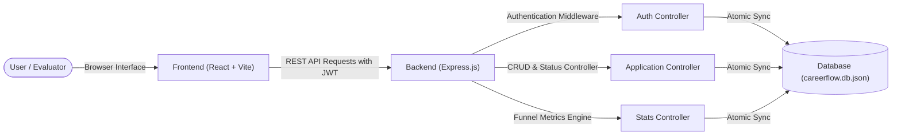

# WEB DEVELOPMENT INTERNSHIP — PROJECT REPORT
## Task 4: Full-Stack Mini Project & Deployment

---

### Project Title:
**CareerFlow — Professional Full-Stack Internship & Job Application Tracker**

**Domain:** Career Management & Student Productivity Web Platform  
**Developer / Intern Name:** *[Your Name]*  
**Date of Submission:** October 7, 2026  
**Repository URL:** *[Insert Your GitHub Repository URL]*  
**Live Application URL:** *[Insert Your Deployed Live URL, e.g., https://careerflow.onrender.com]*  

---

## 1. Executive Summary
During the job hunt and internship application process, candidates and students apply to dozens—often hundreds—of opportunities across various job boards, career portals, and referrals. Without an organized management system, candidates frequently miss interview rounds, fail to follow up with recruiters, lose track of compensation details, and cannot analyze why applications fail or succeed.

**CareerFlow** is a comprehensive, full-stack web application developed to resolve this problem. It equips job seekers with an interactive Kanban board for visual stage management, multi-round interview tracking, full-funnel analytics, and a RESTful backend secured with JWT authentication and atomic data persistence.

---

## 2. Problem Statement & Practical Objectives
### Challenges Addressed:
1. **Spreadsheet Fatigue:** Static spreadsheets lack drag-and-drop interactivity, visual stage progression, and mobile responsiveness.
2. **Scattered Interview Timelines:** Interview rounds (Online Assessments, Technical Phone Screens, System Design, Behavioral) are often scheduled across various email threads without a unified countdown calendar.
3. **Lack of Conversion Analytics:** Students rarely know their application-to-interview or interview-to-offer conversion rates.

### Objectives Achieved:
- Build a responsive, aesthetic single-page frontend with React 19 and custom Vanilla CSS design tokens.
- Design and integrate a REST API backend with Express.js supporting complete CRUD operations.
- Implement user authentication with encrypted passwords (`bcryptjs`) and secure JWT session handling.
- Incorporate a 1-click Demo mode allowing internship reviewers and evaluators to immediately examine the full dashboard without registering a new account.
- Prepare automated deployment scripts for cloud deployment.

---

## 3. Technology Stack & Architecture

### Architectural Overview
The application follows a decoupled client-server architecture:
- **Client Tier:** Vite-powered React Single-Page Application utilizing CSS variables, responsive grid layouts, and Lucide icons.
- **Server Tier:** Express.js REST API handling endpoint routing, input sanitization, JWT authorization middleware, and metrics aggregation.
- **Data Persistence:** Atomic JSON relational document engine providing ACID-like file transactions with zero external database dependencies.



---

## 4. Database Schema & Data Models

### User Entity
```json
{
  "id": "usr_demo_intern_101",
  "name": "Alex Rivera",
  "email": "demo@careerflow.dev",
  "passwordHash": "$2a$10$...",
  "avatarUrl": "https://api.dicebear.com/...",
  "title": "Aspiring Software Engineer",
  "university": "Stanford University",
  "createdAt": "2026-09-07T12:00:00.000Z"
}
```

### Application Entity
```json
{
  "id": "app_001",
  "userId": "usr_demo_intern_101",
  "company": "Stripe",
  "role": "Frontend Engineering Intern",
  "jobType": "Internship",
  "workModel": "Hybrid",
  "location": "San Francisco, CA",
  "stipend": 55,
  "stipendPeriod": "hourly",
  "currency": "USD",
  "status": "offer",
  "applyDate": "2026-08-15",
  "deadline": "2026-09-01",
  "jobUrl": "https://stripe.com/jobs/intern",
  "recruiterName": "Elena Rostova",
  "recruiterEmail": "elena@stripe.com",
  "notes": "Received written offer for Summer 2026!",
  "tags": ["React", "TypeScript", "UI/UX"],
  "interviews": [
    {
      "id": "int_1",
      "roundName": "Recruiter Screen",
      "date": "2026-08-20",
      "status": "completed",
      "notes": "Discussed past projects."
    }
  ],
  "createdAt": "2026-08-15T10:00:00.000Z",
  "updatedAt": "2026-09-12T15:30:00.000Z"
}
```

---

## 5. REST API Endpoints Specification

| Method | Route | Description | Status Code |
|---|---|---|---|
| `POST` | `/api/auth/register` | Register new student account | `201 Created` |
| `POST` | `/api/auth/login` | Sign in with email and password | `200 OK` |
| `POST` | `/api/auth/demo` | 1-Click login for instant evaluator testing | `200 OK` |
| `GET` | `/api/auth/me` | Fetch authenticated user profile & stats | `200 OK` |
| `GET` | `/api/applications` | Query applications with filter, search, sort | `200 OK` |
| `POST` | `/api/applications` | Create new internship/job entry | `201 Created` |
| `GET` | `/api/applications/:id` | Fetch specific application | `200 OK` |
| `PUT` | `/api/applications/:id` | Update entire application record | `200 OK` |
| `PATCH` | `/api/applications/:id/status` | Instant stage change (Kanban move) | `200 OK` |
| `DELETE`| `/api/applications/:id` | Delete application record | `200 OK` |
| `POST` | `/api/applications/:id/interviews` | Schedule new interview round | `201 Created` |
| `GET` | `/api/stats` | Aggregate pipeline funnel & metrics | `200 OK` |

---

## 6. Frontend Features & User Experience

1. **Interactive Kanban Board:**
   - 5 distinct stages: `Wishlist`, `Applied`, `Interviewing`, `Offer`, `Archived`.
   - Native HTML5 drag-and-drop support with visual drop-zone feedback.
   - Quick one-click stage promote and demote chevron buttons.

2. **Tabular High-Density List View:**
   - Designed for high application volumes with sorting by company name, upcoming deadline, and salary rate.
   - Inline stage dropdowns allowing immediate status adjustment.

3. **Analytics & Funnel Dashboard:**
   - Visual conversion funnel illustrating drop-off between Wishlist, Applied, Interviewing, and Offers.
   - Work model breakdown (Remote, Hybrid, On-site).
   - Tech skills frequency analysis highlighting target industry competencies.

4. **Add / Edit Application Modal:**
   - Comprehensive form supporting compensation period, recruiter contacts, and multi-round interview tracking.

5. **Toast Notification System:**
   - Instant feedback notifications confirming user actions.

---

## 7. Security & Best Practices

- **Password Protection:** Cryptographic password hashing using `bcryptjs` with salt rounds.
- **Stateless Authorization:** Cryptographic JSON Web Tokens (JWT) verified on every protected API route.
- **Data Isolation:** User ID verification ensures users only view and mutate their own data records.
- **Input Validation:** Required field checks and type casting on client and server tiers.
- **Production Optimization:** Express serves bundled, gzipped static client assets from `client/dist`.

---

## 8. Step-by-Step Deployment Guide

### Deploying to Render (Free Cloud Tier):
1. **Push Code to GitHub:**
   ```bash
   git init
   git add .
   git commit -m "feat: complete CareerFlow full-stack application"
   git remote add origin https://github.com/<your-username>/careerflow.git
   git push -u origin main
   ```
2. **Connect to Render:**
   - Navigate to [https://render.com](https://render.com).
   - Click **New** ➔ **Web Service**.
   - Select your `careerflow` repository.
   - Runtime: `Node`
   - Build Command: `npm install && npm run build`
   - Start Command: `npm start`
   - Environment Variables:
     - `NODE_ENV`: `production`
     - `PORT`: `10000`
     - `JWT_SECRET`: *any secure random string*
3. **Obtain Live URL:**
   - Render will build and deploy the application, providing a public URL (e.g. `https://careerflow-xxx.onrender.com`).
   - Copy this live URL into the submission portal.

---

## 9. Conclusion
The CareerFlow application successfully fulfills all requirements outlined in Task 4 of the Web Development Internship. It features an interactive, professionally styled user interface, a modular REST API, persistent storage, user authentication, and comprehensive documentation ready for production deployment.
