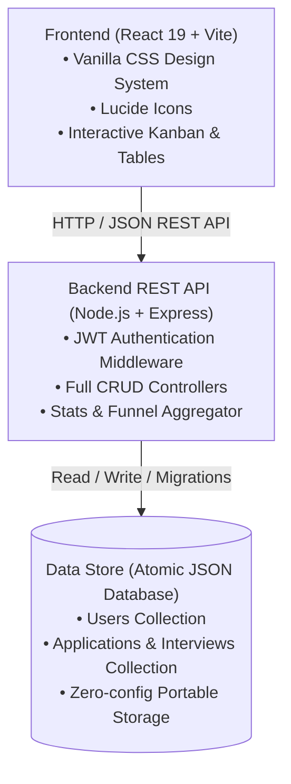

# 🚀 CareerFlow — Next-Gen Internship & Job Application Tracker

[](https://nodejs.org/)
[](https://react.dev/)
[](https://vitejs.dev/)
[](https://expressjs.com/)
[](LICENSE)

> A modern full-stack web application built to solve candidate and student internship tracking challenges with interactive Kanban pipeline boards, analytics funnels, and multi-round interview management.

Developed for **Web Development Internship — Task 4: Full-Stack Mini Project & Deployment**.

---

## 🌟 Highlights & Key Features

### 1. Interactive Pipeline Kanban Board
- **5 Pipeline Stages**: `Wishlist` 💡, `Applied` 📨, `Interviewing` 🎯, `Offer` 🎉, and `Archived` 📋.
- **HTML5 Drag-and-Drop & Instant Arrow Navigation**: Effortlessly promote applications between stages.
- **Visual Status Badges**: Immediate visibility of deadlines, work models (Remote/Hybrid/On-site), and compensation.

### 2. Multi-View Experience
- **Kanban Board**: Visual drag-and-drop workflow.
- **Table / List View**: High-density view with sorting by company, application date, deadline, and highest stipend.
- **Analytics & Insights**:
  - Application conversion funnel (Applied ➔ Interviews ➔ Offers).
  - Work model distribution breakdown (Remote vs. Hybrid vs. On-site).
  - High-frequency demanded tech stack & skills tags.
  - Upcoming scheduled interview countdown.

### 3. Full CRUD REST API with Authentication
- Secure JWT-based authentication with bcrypt password hashing.
- **1-Click Demo Login**: Instantly test the application preloaded with realistic internship applications (Stripe, Google, Vercel, Figma, etc.).
- Robust validation, pagination/filtering parameters, and error handling.

### 4. Bespoke Glassmorphism Design System
- Pure Vanilla CSS design tokens (custom theme, HSL colors, no heavy CSS utility dependencies).
- Typography powered by Google Fonts: *Outfit* and *Plus Jakarta Sans*.
- Floating toast notifications and responsive layout across desktop, tablet, and mobile.

---

## 📐 Architecture & Tech Stack



| Layer | Technology | Purpose |
|---|---|---|
| **Frontend** | React 19, Vite, Lucide React | High-performance SPA with client routing and state |
| **Styling** | Vanilla CSS3 (CSS Variables, Glassmorphism) | Sleek modern aesthetics without heavy CSS frameworks |
| **Backend** | Node.js, Express.js | Modular REST API with structured controllers & middleware |
| **Authentication** | JWT (`jsonwebtoken`), `bcryptjs` | Stateless secure token auth & password hashing |
| **Database** | Atomic JSON Document Engine | Reliable, zero-config relational store with auto-seeding |

---

## 📂 Project Structure

```
careerflow/
├── client/                     # Frontend Application
│   ├── index.html              # HTML shell with Google Fonts
│   ├── vite.config.js          # Vite config with API proxy
│   ├── package.json
│   └── src/
│       ├── main.jsx            # React root with AuthProvider
│       ├── App.jsx             # Main dashboard logic & views
│       ├── index.css           # Vanilla CSS design tokens & animations
│       ├── components/
│       │   ├── Navbar.jsx          # Top navigation with live stats & auth
│       │   ├── StatCards.jsx       # 4 Key metrics summary cards
│       │   ├── FilterBar.jsx       # Search, stage pills, sort & view tabs
│       │   ├── KanbanBoard.jsx     # Drag-and-drop pipeline board
│       │   ├── ApplicationCard.jsx # Draggable stage card with actions
│       │   ├── ApplicationTable.jsx# High-density list table view
│       │   ├── AnalyticsView.jsx   # Funnel & skill demand visual charts
│       │   ├── ApplicationModal.jsx# Full CRUD modal with interview rounds
│       │   ├── AuthModal.jsx       # Sign in / Register / 1-Click Demo
│       │   └── Toast.jsx           # Animated floating notifications
│       ├── context/
│       │   └── AuthContext.jsx     # Global authentication state
│       └── services/
│           └── api.js              # Fetch client for REST endpoints
├── server/                     # Backend REST API
│   ├── package.json
│   ├── server.js               # Express application entrypoint
│   ├── config/
│   │   └── db.js               # Atomic storage engine & seed loader
│   ├── controllers/
│   │   ├── authController.js       # Register, login, demo, me
│   │   ├── applicationController.js# Applications CRUD + status PATCH
│   │   └── statsController.js      # Funnel & pipeline metrics calculations
│   ├── middleware/
│   │   └── authMiddleware.js       # JWT bearer verification
│   ├── routes/
│   │   ├── authRoutes.js
│   │   ├── applicationRoutes.js
│   │   └── statsRoutes.js
│   └── data/
│       ├── seed.js                 # Database seed utility
│       └── careerflow.db.json      # Persistent data store
├── package.json                # Root scripts (concurrently dev & build)
├── render.yaml                 # 1-Click Render cloud configuration
├── PROJECT_REPORT.md           # Formal project report for submission
└── README.md
```

---

## ⚡ Quick Start (Running Locally)

### Prerequisites
- [Node.js](https://nodejs.org/) v18 or higher (Node 20+ recommended)
- [npm](https://www.npmjs.com/) v9 or higher

### 1. Installation
Clone the repository and install all dependencies:
```bash
# Clone the repository
git clone https://github.com/your-username/careerflow.git
cd careerflow

# Install root dependencies
npm install

# Install client and server dependencies
npm --prefix client install
npm --prefix server install
```

### 2. Run in Development Mode
Run both frontend and backend concurrently with hot reloading:
```bash
npm run dev
```
- **Frontend App**: `http://localhost:5173`
- **Backend REST API**: `http://localhost:5000`

### 3. Build & Run Single Full-Stack Production Server
```bash
# Build frontend
npm run build

# Start integrated production server (serves frontend & API on port 5000)
npm start
```
Access the application at `http://localhost:5000`.

---

## 📡 REST API Documentation

### Authentication Endpoints
| Method | Endpoint | Description | Auth Required |
|---|---|---|---|
| `POST` | `/api/auth/register` | Create a new student/candidate account | No |
| `POST` | `/api/auth/login` | Sign in with email and password | No |
| `POST` | `/api/auth/demo` | 1-Click instant demo login (Evaluator friendly) | No |
| `GET` | `/api/auth/me` | Fetch authenticated user profile & summary stats | Yes (Bearer) |

### Application CRUD Endpoints
| Method | Endpoint | Description | Auth Required |
|---|---|---|---|
| `GET` | `/api/applications` | List applications (supports `search`, `status`, `sortBy`) | Yes (Bearer) |
| `POST` | `/api/applications` | Create a new tracked application | Yes (Bearer) |
| `GET` | `/api/applications/:id` | Fetch details of a specific application | Yes (Bearer) |
| `PUT` | `/api/applications/:id` | Update entire application details | Yes (Bearer) |
| `PATCH` | `/api/applications/:id/status`| Quick stage transition (Kanban move) | Yes (Bearer) |
| `DELETE` | `/api/applications/:id` | Delete application record | Yes (Bearer) |
| `POST` | `/api/applications/:id/interviews` | Add an interview round | Yes (Bearer) |

### Analytics Endpoint
| Method | Endpoint | Description | Auth Required |
|---|---|---|---|
| `GET` | `/api/stats` | Pipeline funnel, work models, and top skills | Yes (Bearer) |

---

## 🌐 Deployment Instructions

### Deploy to Render (Recommended Free Cloud Hosting)
1. Push code to your GitHub repository.
2. Sign in to [Render](https://render.com).
3. Click **New +** ➔ **Web Service** ➔ connect your GitHub repository.
4. Configure settings:
   - **Environment**: `Node`
   - **Build Command**: `npm install && npm run build`
   - **Start Command**: `npm start`
   - **Environment Variables**:
     - `NODE_ENV`: `production`
     - `PORT`: `10000`
     - `JWT_SECRET`: *(generate random string)*
5. Click **Create Web Service**. Your live URL will be active in ~2 minutes!

---

## 📄 License
This project is licensed under the MIT License.
